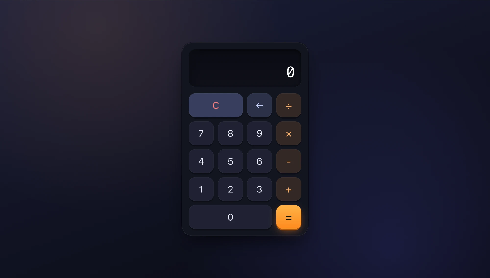
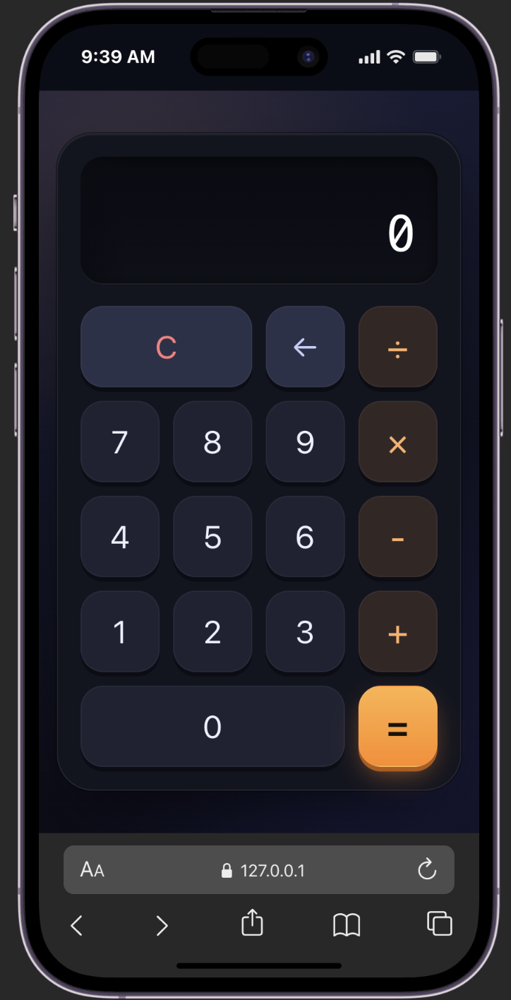
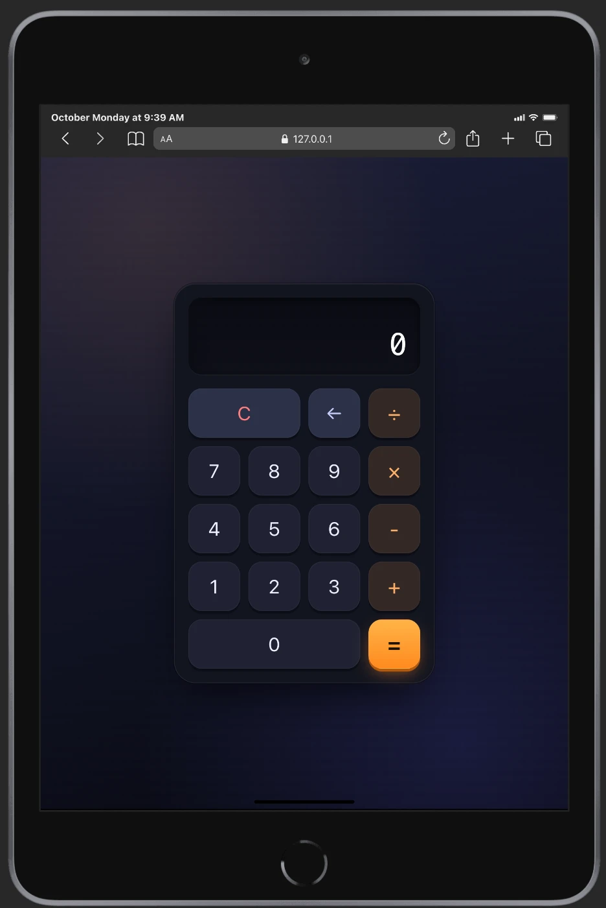

# Calculator

A clean, responsive calculator built with **vanilla HTML, CSS and JavaScript** — no frameworks, no build step, no dependencies.


<!--
  Live demo: add the GitHub Pages link here once it is enabled, e.g.
  **[Live demo →](https://daniloK77.github.io/calculator-js/)**
-->

## Screenshots

### Desktop



### Mobile and tablet

<table>
  <tr>
    <td align="center" width="50%"><br><sub>iPhone</sub></td>
    <td align="center" width="50%"><br><sub>iPad</sub></td>
  </tr>
</table>

## Features

- Addition, subtraction, multiplication and division
- Clear (`C`) and backspace (`←`)
- Chained operations (`5 × 2 × 3 = 30`)
- Responsive layout that works from phones to desktops
- Long numbers stay readable — the display keeps the newest digits in view
- Keyboard-focus styles and ARIA labels on the keypad for accessibility

## Tech Stack

| Layer | Technology |
| ----- | ---------- |
| Markup | Semantic HTML5 (`<main>`, `<output>`, `<section>`) |
| Styling | CSS3 — Grid, custom properties, gradients, transitions |
| Logic | Vanilla JavaScript (ES6+) |

## Getting Started

No installation needed. Clone the repository and open `index.html` in your browser:

```bash
git clone https://github.com/DaniloK77/calculator-js.git
cd calculator-js
open index.html        # macOS — or just double-click the file
```

Or serve it locally:

```bash
python3 -m http.server 8000
# then visit http://localhost:8000
```

## Project Structure

```
.
├── index.html       # Page structure and keypad markup
├── styles.css       # Layout, theme and responsive styles
├── calculator.js    # Calculator state and button handling
├── docs/
│   └── screenshots/ # Images used in this README
└── README.md
```

## How It Works

The calculator keeps three pieces of state:

| Variable | Purpose |
| -------- | ------- |
| `buffer` | The number currently being typed (shown on the display) |
| `runningTotal` | The result of the operations entered so far |
| `previousOperator` | The operator waiting to be applied to the next number |

A single click listener on the keypad (**event delegation**) reads the pressed button's text and routes it either to `handleNumber` or `handleSymbol`. After every press, `rerender()` writes the buffer to the display.

## Design Notes

- **CSS Grid keypad** — the `C` and `0` keys span multiple columns with simple `span-2` / `span-3` modifier classes.
- **Design tokens** — colors, radii and spacing live in CSS custom properties at the top of `styles.css`, so the theme is easy to change in one place.
- **Tactile feedback** — keys have hover, pressed and keyboard-focus states; motion is disabled for users who prefer reduced motion.
- **Responsive sizing** — the calculator scales down on small screens without horizontal scrolling.

## Roadmap

- [ ] Decimal point support
- [ ] Keyboard input (digits, operators, `Enter`, `Backspace`, `Esc`)
- [ ] Graceful handling of division by zero and invalid input
- [ ] Show the running expression above the result
- [ ] Unit tests for the calculation logic
- [ ] Deploy with GitHub Pages

## Author

**Danilo Kovacevic** — [@DaniloK77](https://github.com/DaniloK77)
